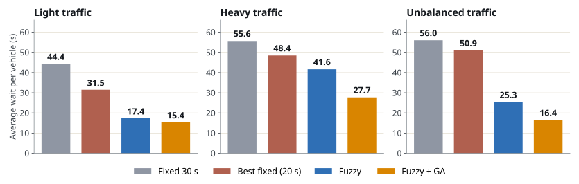

# Intelligent Traffic Signal Control Using Fuzzy Logic and Optimization

A traffic signal that looks at the queue before it decides how long to stay green.

This is my Foundations of AI project (PBL) at Woxsen University. A Mamdani fuzzy controller reads the queues at a four-way intersection and decides how long to extend the green. A Genetic Algorithm then tunes the controller's membership functions to bring the average waiting time down.

**Author:** Mohammed Amaan Khan (25WU0101075), B.Tech CSE
**Mentor:** Dr Bhargav Prajwal Pathri

## Live prototype

Open `index.html` in any browser. No install and no server needed.

- Watch the intersection run under any of the four controllers
- Switch between light, heavy and unbalanced traffic
- See the last fuzzy decision and how strongly each rule fired
- Run a one-hour benchmark of all four controllers in the browser

## Results

Average waiting time per vehicle in seconds, mean of 10 one-hour runs on traffic the Genetic Algorithm never saw.

| Controller | Light | Heavy | Unbalanced |
| --- | --- | --- | --- |
| Fixed 30 s | 44.4 | 55.6 | 56.0 |
| Best fixed (20 s) | 31.5 | 48.4 | 50.9 |
| Fuzzy (hand-set) | 17.4 | 41.6 | 25.3 |
| **Fuzzy + GA** | **15.4** | **27.7** | **16.4** |

The tuned controller waits 65%, 50% and 71% less than the 30 second timer. Throughput is within 1% for all four, so the gain is in delay, not in volume.



## How it works

1. **Simulator.** Four roads, one-second steps, Poisson arrivals. One vehicle leaves every 2 s of green. Every phase change costs 3 s.
2. **Fuzzy controller.** Two inputs (queue on the green road, longest queue on the red roads), one output (green extension), nine rules, centroid defuzzification.
3. **Genetic Algorithm.** 15 genes (5 per fuzzy variable), population 30, 40 generations, tournament selection, uniform crossover, Gaussian mutation, elitism and a repair step.
4. **Testing.** Trained on 3 seeds per scenario, tested on 10 different seeds per scenario.

## Run the experiment

```
pip install numpy matplotlib
python traffic_fuzzy_ga.py    # about a minute, writes results.json
python make_charts.py         # writes charts/
```

## Files

| File | What it does |
| --- | --- |
| `traffic_fuzzy_ga.py` | Simulator, controllers, fuzzy engine, Genetic Algorithm, experiment |
| `make_charts.py` | Draws the charts from `results.json` |
| `results.json` | Saved output of the full experiment |
| `sim.js` | JavaScript port of the simulator and fuzzy engine |
| `app.js`, `index.html` | The prototype page |
| `data.js` | Tuned and hand-set genes exported for the browser |
| `docs/` | Case study report (PDF) |

The browser prototype uses its own random number generator, so its numbers differ from the Python table by a second or two. The ranking of the controllers is the same.

## Limitations

Simulated traffic, one isolated junction, one lane per road, fixed phase order, and only the membership functions are tuned. The report in `docs/` covers these in detail along with the next steps.
